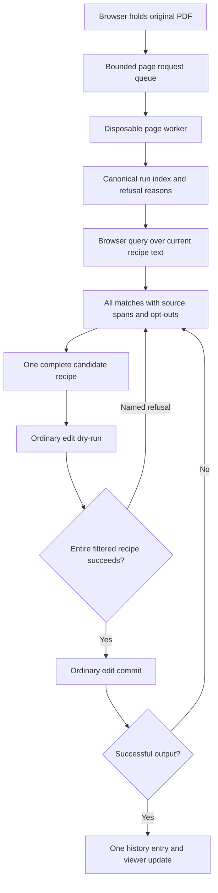

# Phase 5: Find and Replace Across All Pages — Research Update

**Researched:** 2026-10-22  
**Domain:** Current Phase 4 search, recipe and worker contracts  
**Confidence:** HIGH for measured behavior; MEDIUM for performance improvement until remeasured.

<user_constraints>
## User Constraints (from CONTEXT.md)

The following decision and deferred sections are copied verbatim from `05-CONTEXT.md`. [VERIFIED: 05-CONTEXT.md]

## Implementation Decisions

### Settled upstream — do not relitigate

- **D-5.1: There is no bulk find-replace endpoint.** `REQUIREMENTS.md` lists "A separate bulk
  find-replace endpoint" in its **Out of Scope** table, and `ROADMAP.md` restates the reason: find
  is a client-side query over the cached index producing N ordinary overrides. A bulk endpoint
  means two rewrite implementations within six months. Replace-all therefore goes through the same
  apply path a single edit does.

- **D-5.2: Find and replace are two features, built in that order.** `ROADMAP.md` is explicit:
  build the match list and preview (FIND-01..05) *before* wiring apply (FIND-06). Find depends only
  on the Phase 2 index, not on the rewrite engine, so it demos early and de-risks replace by making
  its inputs visible. The roadmap names estimating them as one item as the most likely source of a
  blown estimate. Wave structure must reflect the split.

- **D-5.3: Search normalization is the interpreter's own normalization, not a second one.**
  FIND-01 requires intra-word TJ adjustments collapsed and ligatures normalized — using the same
  normalization the Phase 2 interpreter used. A second normalization path anywhere is the same
  smell EXPO-05 names for extraction: a signal the text model is under-specified. If the Phase 2
  index does not already expose the normalized form, the fix is to expose it, not to re-derive it.

- **D-5.4: Unreplaceable matches are shown, disabled, with a reason — never filtered out.**
  FIND-05, and it is the same refusal discipline as CLAS-04 and EDIT-04: refuse the operation
  visibly with a named reason, never silently. The reason strings should come from the existing
  Phase 2/Phase 3 refusal vocabulary rather than a new parallel set of user-facing strings.

- **D-5.5: One Ctrl+Z reverts an entire replace-all batch as a single step.** EDIT-05 and ROADMAP
  criterion 5. Phase 4's undo store must already admit a batch; this phase is the first thing that
  produces one.

### Claude's Discretion

- Whether the match index is built eagerly at document open or lazily on first search, and how it
  is cached client-side.
- Match-list virtualization / pagination strategy for large result sets.
- How "surrounding context" (FIND-03) is windowed and how much is shown.
- Whether opt-out state (FIND-04) is per-match boolean or a selection model.
- Whether replace-all applies as one recipe with N ops or N recipes; subject to D-11
  (all-or-nothing) from Phase 3 and to D-5.5's single-step undo.
- How progress is reported for a long replace-all across 40 pages.

## Deferred Ideas

- Regex / wildcard search — not in FIND-01..06.
- Search across multiple open documents — no multi-document session model exists.
- Replace with formatting changes (FONT-07 applies to a single edited run in Phase 4; batch
  restyling is not in scope here).

Execution amendment: build locally; do not deploy. Keep Phase 4 Linux/container/CDN release gates pending. [VERIFIED: 05-CONTEXT.md execution amendment]
</user_constraints>

## Summary

Build find first, then replace through the existing `POST /jobs/{id}/edit`. Current preview runs `apply_recipe` in disposable worker scratch and returns a report without PDF bytes. There is no public plan endpoint. [VERIFIED: server/app.py:238; server/worker.py:_execute]

**Primary recommendation:** make canonical normalization and source offsets explicit, reuse the existing queue/session/undo helpers, and schedule engine batching performance work before G4. The realistic 675-op accepted batch currently dies inside the existing worker budget; a larger recipe cap cannot fix this. [VERIFIED: measurements below; engine/recipe.py; client/src/session.mjs]

This update supersedes the old research's absent-client-test-framework, hypothetical endpoint, old refusal fixtures and unbounded plan-only performance conclusions. No production code, limits, public corpus files or release status were changed by this research. [VERIFIED: current client/src/session.test.mjs; current worker; research task scope]

## Architectural Responsibility Map

| Capability | Primary Tier | Secondary Tier | Contract |
|---|---|---|---|
| TJ gap interpretation | Engine | — | Consume `RunRecord.display_text`; no client spacing heuristics. [VERIFIED: engine/clusterer.py:_display_text] |
| Canonical search projection | Engine-owned shared data/helper | Browser | New versioned projection contract described below; one definition for source/query/override. [VERIFIED: FIND-01; present normalization gap] |
| All-page loading/search/opt-outs | Browser | Existing page API | Reuse bounded queue, abort and original-source recovery. [VERIFIED: client/src/App.jsx; session.mjs] |
| Fit, rewrite safety, output bytes | Disposable worker | Recipe/rewrite engine | Preview and commit same filtered recipe through ordinary edit. [VERIFIED: server/worker.py] |
| One-step undo | Browser | Worker when prior recipe is nonempty | One `commitRecipe` after successful batch, replay against original. [VERIFIED: client/src/session.mjs; App.jsx:undo] |

## Project Constraints (from AGENTS.md)

No repository `./AGENTS.md` exists. The supplied instruction requires the installed graphify skill before acting on explicit `/graphify`; this research task does not invoke that command. `CLAUDE.md` additionally requires content-stream edits, no reflow, no document content in logs, original bytes authoritative in the browser, evictable server source cache, and no AGPL runtime dependency. [VERIFIED: filesystem probe; supplied user instructions; CLAUDE.md]

## Standard Stack

Reuse installed dependencies and lockfiles; do not add a test framework or runtime search dependency. Values below are installed/locked versions, not recommendations to upgrade. [VERIFIED: client/package-lock.json; .venv runtime probes]

| Component | Current version | Use |
|---|---|---|
| Python / Unicode DB | 3.13.7 / 15.1.0 | Authoritative generation and canonical reference. [VERIFIED: runtime probe] |
| React / Vite | 18.3.1 / 5.4.21 | Existing JavaScript UI. [VERIFIED: client/package-lock.json] |
| pdfjs-dist / @cantoo/pdf-lib | 6.2.108 / 2.9.1 | Existing viewer/page stack. [VERIFIED: client/package-lock.json] |
| pytest | 9.1.1 | Existing Python tests. [VERIFIED: runtime probe] |
| Node built-in tests | Node 22.23.2 | Existing 12 session helper tests pass. [VERIFIED: node --test client/src/session.test.mjs] |

**Installation:** none. **Package Legitimacy Audit:** not applicable; no external package install is recommended. Keep existing resolved dependencies. [VERIFIED: implementation recommendation above]

## Architecture Patterns

### System Architecture Diagram



Diagram ownership follows the current original-byte replay and worker boundary. [VERIFIED: App.jsx; server/worker.py; engine/recipe.py]

### Canonical normalization contract — required before search

**Observed gap:** `display_text` joins decoded glyph Unicode and the clusterer's existing synthetic spaces; `RunRecord` and the page response currently expose no NFKD/casefold/source-offset projection. Fix that at the engine/index boundary. Do not reinterpret TJ adjustments or remove spaces in browser search. [VERIFIED: engine/records.py:RunRecord; engine/clusterer.py:_display_text; server/worker.py:page]

**Decision for planning:** use engine-owned, checked-in generated Unicode data and a small shared canonical contract, with Python as the reference. Generate sparse full decomposition, full default casefold and canonical-combining-class tables from pinned Python 3.13 / Unicode 15.1.0; consume them in the browser helper for query and current recipe override projections. Expose the source projection through the existing page run response. This is shared Unicode data, not a handwritten casefold approximation. Current Node reports Unicode 17.0 / ICU 78.2, so relying on browser/Node normalization tables to equal Python's by coincidence is insufficient. [VERIFIED: Python/Node probes; cited Python unicodedata documentation; FIND-01]

Define:
- Case-sensitive key: `NFKD(text)`.
- Default key: `NFKD(NFKD(text).casefold())`, with default locale-independent full casefold.
- Preserve accents, punctuation and the interpreter's whitespace. Never use the normalized key as replacement text.
- Attach `normalization_version: "ucd-15.1.0-nfkd-fullfold-v1"`.
- Keep `text` unchanged; expose `search: {version, sensitive: {text, spans}, folded: {text, spans}}`.
- `spans[i] = [startUTF16, endUTF16]` is the half-open source interval that produced normalized UTF-16 code unit `i`. Every unit of an expanded scalar inherits its original interval; both units of an astral scalar inherit the same interval. Carry those tags through canonical reordering.
- Iterate input by Unicode scalar and maintain an independent UTF-16 offset accumulator. Stable canonical ordering must run across adjacent decompositions; scalar-by-scalar normalization followed by concatenation alone is incorrect for reordered marks.  
These are the recommended implementation contract; NFKD's decomposition/ordering and Python full casefold behavior come from the cited standard references. [CITED: https://www.unicode.org/reports/tr15/tr15-57.html] [CITED: https://docs.python.org/3.13/library/unicodedata.html] [CITED: https://docs.python.org/3.13/library/stdtypes.html#str.casefold]

**Replacement boundaries:** a normalized match `[a,b)` becomes a replaceable source span only if (1) its mapped source intervals cover one contiguous source interval, (2) every normalized unit produced by every source scalar in that interval lies inside `[a,b)`, and (3) both source endpoints are grapheme boundaries. Use native `Intl.Segmenter('en', {granularity:'grapheme'})` for the final source-boundary check, not code-unit slicing alone. Mapping by `min(start), max(end)` without the inverse-coverage check loses text. These are proposed safety invariants derived from the expansion/reordering contract, not an existing engine capability. [VERIFIED: normalization contract above] [CITED: https://tc39.es/ecma402/#sec-intl.segmenter]

| Source and query | Required result |
|---|---|
| `fi`, query `fi` | One source span `[0,1)`; full ligature replacement allowed subject to ordinary fit/safety. |
| `fi`, query `f` | Match stays visible, disabled: `normalization_boundary_unreplaceable`; never delete the unselected `i`. |
| `ß`, insensitive query `ss` | Whole expansion maps to `[0,1)`; case-sensitive `ss` does not match. |
| `ß`, insensitive query `s` | Partial expansion stays visible disabled; do not create two destructive ops for one scalar. |
| `é` or `e + U+0301` | Full canonical sequence matches equivalently; partial base/mark is disabled if it splits the source grapheme. |
| Astral prefix then `fi` | Source span starts at UTF-16 offset 2, never 1; no surrogate half is sliced. |
| Reordered combining marks | Preserve provenance through reorder; require full coverage and grapheme boundaries. |
| Repeated matches in one run | Distinct non-overlapping source spans, per-instance opt-out, one final op for that source run. |

The rows specify the recommended safety contract. Add the one search-boundary reason only where existing engine refusal vocabulary has no equivalent; preserve all existing engine reasons verbatim. [VERIFIED: engine/refusal producers and current session.mjs reason handling; requirements FIND-04/FIND-05]

**Whole words:** segment the actual selected normalized haystack with `Intl.Segmenter('en', {granularity:'word'})`; require both match endpoints to be segment boundaries. Do not use ASCII `\b` or lowercasing as Unicode casefold. Test accented Latin, Greek, combining text, identifiers with underscores, apostrophes, non-Latin text and astral offsets. Native segmentation is locale/runtime dependent; pin the requested locale, record supported browser results, and disable the toggle with an explanation if Segmenter is unavailable instead of silently changing semantics. [CITED: https://tc39.es/ecma402/#sec-intl.segmenter] [CITED: https://www.unicode.org/reports/tr29/]

### Current recipe and match identity

For each source run, search `recipe.find(op.run_id)?.new_text ?? sourceRun.text`; retain original `run_id`, original display text and existing style. Project the effective override through the same helper. Match identity includes source run ID, effective text/recipe revision, normalized interval and source interval. A query/replacement/toggle/opt-out/document/recipe change invalidates the preview and resets stale match selections. [VERIFIED: App.jsx:choose/candidate and original replay; proposed FIND-04 contract]

Choose deterministic left-to-right non-overlapping substring matches, advance by normalized query length, and reject empty queries. Build each run's new text using selected safe source spans from right to left against effective text, merge into the existing recipe with `upsertOperation`, and carry through existing style. Never apply replacements to a normalized string or rebase IDs onto edited output bytes. [VERIFIED: session.mjs:upsertOperation; engine/recipe.py source-hash/duplicate guards; proposed replacement contract]

### Complete-document loading and atomic preview/filter/apply

Reuse `documentRequest`, `createRequestQueue(limit:2)`, priority promotion, bounded 429 retry, AbortController and source reupload. Extend failed-page bookkeeping: current `fetchRuns` deletes a rejected pending entry and emits a message but does not retain a failed-page state. Show loading/completed/failed pages and distinguish a partial match count. Allow retry; never claim all-page completeness while a page is missing or failed. Empty/scanned/refused pages count as successfully indexed when their page result is available. [VERIFIED: App.jsx:fetchRuns; session.mjs helpers; FIND-01/FIND-05]

Preview the complete candidate recipe through `/edit?dry_run=true`. Keep classify-time, fit-time and actual splice refusals in visible disabled rows. Filter only newly requested replacement operations/instances, preserving the prior committed recipe. Then preview the exact filtered candidate again; apply only a fully successful, fresh preview. Never interpret other `ok=True` rows from an overall failed apply report as proof they were actually rewritten: `_refuse_at` changes only the failed row and leaves later planned rows untouched. A worker error has no per-run safety verdict; retain rows and display the batch error. A named refusal on a pre-existing committed op blocks the candidate rather than silently dropping history. [VERIFIED: worker:_execute; recipe:_refuse_at/apply_recipe; session.mjs history]

One HTTP commit carries the full filtered recipe; one successful `commitRecipe` adds one undo entry. No per-page incremental commits, no bulk endpoint, no auto-retry loop of failed commits. Signature acknowledgment and preview version checks still apply. [VERIFIED: D-5.1/D-5.5; App.jsx:apply/undo; worker signature gate]

## Live 40-page Measurement and Performance Blocker

Immutable source: `corpus/public/govdocs1_013_013050.pdf`; SHA-256 `d0a3b06606378733a2ec96cfa01e3b12c111d13059d070e3e039b751347a4529`; 40 pages, 3,000 runs. Common fixed ASCII query `the` → `a`, insensitive substring: 1,029 instances, 772 distinct run ops on 38 pages. In-process index pass: 1.101s. This is source-wide search including pages without matches, not a promise that all 40 pages contain the query. [VERIFIED: /private/tmp/phase5-readiness.py and phase5-readiness-results.json]

| Ordinary isolated worker call | Ops / JSON bytes | Wall / aggregate child CPU | Outcome |
|---|---:|---:|---|
| Internal plan action (not public route) | 772 / 122,986 | 4.985s / 4.938s | 97 refusals, no PDF |
| Actual edit preview of same unfiltered recipe | 772 / 122,986 | 5.004s / 4.969s | Same 97 refusals, no PDF |
| Actual edit preview after plan refusals filtered | 675 / 107,593 | 23.246s / 22.058s | `WORKER_FAILED`, no report/PDF |
| Actual edit apply of that same filtered recipe | 675 / 107,593 | 23.266s / 22.045s | `WORKER_FAILED`, no report/PDF |
| Live sparse ordinary preview / apply | 1 / 186 | 0.536s / 0.510s wall | Both successful; only apply returns PDF |

All measurements use `run_worker` with explicit 40s research wall allowance, unchanged 20s worker CPU limit, existing preflight/fidelity checks and source-address IDs. Failures occurring before 40s with these CPU totals are consistent with the child CPU cap; the public fixed error code does not expose the termination signal. The source was verified unchanged afterward. Refusals: 75 `operator_shared_by_multiple_runs`, 22 mapping-table refusals across Univers variants. Counts and IDs only were recorded; decoded document text was not logged. [VERIFIED: research script/results; server/worker.py:_set_limits; server/isolation.py:_exchange]

Live successful source ID: `d0a3b06606378733a2ec96cfa01e3b12c111d13059d070e3e039b751347a4529:p5:c0:o1759`. Other sampled source IDs include suffixes `:p0:c7:o1939`, `:p0:c7:o1293`, `:p1:c0:o1455`. Use the live term/ID when establishing a positive control; do not assume older preflight fixtures still remain accepted. [VERIFIED: research results]

**Actual constants:** `MAX_RECIPE_OPS=50_000`; `MAX_NEW_TEXT_CHARS=10_000` per op; API and worker recipe body 1,048,576 bytes; input PDF 50MiB; worker output 80MiB; expanded Flate stream 16MiB; CPU 20s; memory target 1GiB. `run_worker` default wall is 30s, which is what current API dispatch uses; the middleware default deadline is `body_timeout + 35 = 50s`, not a 40s worker default. Do not raise any cap. A candidate must satisfy all limits independently, including the complete existing recipe and UTF-8 encoded JSON body. [VERIFIED: engine/recipe.py:79/84; server/app.py; server/isolation.py; server/worker.py]

### Profile and narrow optimization ownership

Direct `apply_recipe` cProfile on the first 100 plan-accepted ops across 5 pages succeeds, with 33.796s profiled elapsed time. This direct profile is diagnostic, outside request isolation, and includes instrumentation overhead; it is not a successful worker-budget benchmark. [VERIFIED: /private/tmp/phase5-profile.py; phase5-profile-results.json]

| Hotspot | Calls | Cumulative seconds |
|---|---:|---:|
| Page parse | 296 | 21.334 |
| `_matrix_after_run` | 200 | 20.795 |
| `_current_page_runs` | 196 | 20.315 |
| `_rederive_op` | 95 | 10.870 |
| Full PDF save | 292 | 5.382 |
| `plan_recipe` | 1 | 1.129 |

Nested cumulative times overlap; do not add these rows. The observed 296 parses for 100 edits include roughly three walks per ordinary same-part edit. [VERIFIED: profile statistics]

**Required engine task:** `engine/rewrite.py` owns a verified current page snapshot (full run records **and verdicts**) after each successful splice; `engine/recipe.py` owns its per-request reuse and next-op resolution. Keep standalone `rewrite_run` behavior/freshness unchanged by default. Recipe orchestration may explicitly supply an internally created current snapshot, never a caller/browser supplied snapshot. [VERIFIED: current _matrix_after_run/_current_page_runs/_rederive_op contracts; recommended optimization boundary]

Invariants for the optimization:
1. Compare each splice's before sentinel from already-current records with its after sentinel from a genuinely fresh post-splice walk; retain the existing `1e-6` position tolerance and `None` handling.
2. Return/cache the fresh full page records and verdicts only after successful validation; invalidate at every mutation and on failure.
3. Next op uses fresh `_match_run` by part, original text and origin, then `_resolve_op`; never source run ordinal or stale byte offset. Preserve the substitution-key-change refusal.
4. Retain correlation/shared-operator/stateful-showing checks, font restoration, ToUnicode/shaping checks and one document-wide subset union.
5. Discard the mutated PDF on any failure; exactly one final save after every selected op succeeds.
6. Re-run the 675-op worker preview and apply. One walk per edit is an initial optimization, **not proof** of meeting the 20s CPU budget; if still slow, profile again and share parsing/correlation work at the same ordinary recipe boundary without bypassing guards.  
[VERIFIED: engine/recipe.py:_match_run/_rederive_op/apply_recipe; engine/rewrite.py:_matrix_after_run/rewrite_run; proposed optimization invariants]

## Component Responsibilities

| File(s) | Required responsibility |
|---|---|
| `engine/search.py` (new), `engine/index.py` / `engine/records.py` | Canonical projection and provenance contract; expose without altering original text. |
| `tools/build_search_unicode.py`, `engine/data/search-unicode-15.1.json` (new) | Deterministic Unicode 15.1 sparse data, version and regeneration check. |
| `server/worker.py` | Add projection to existing page wire shape; preserve isolation and preview semantics. |
| `client/src/find/search.mjs`, `buildRecipe.mjs`, `replaceAll.mjs` (new) | Pure search, safe inverse spans, word boundaries, opt-outs, current recipe assembly and preview workflow. |
| `client/src/App.jsx`, `session.mjs` | Page completion/failure state, stale-preview invalidation, navigation, ordinary preview/apply/one undo. |
| `engine/rewrite.py`, `engine/recipe.py` | Verified snapshot reuse; performance task before G4. |
| `tests/test_find_normalize_parity.py`, `test_find_replace_recipe.py`, `test_gate_g4.py`; client `*.test.mjs` | Contract, batching, refusal visibility, 40-page renderer gate. |

Names marked new are recommended task boundaries; preserve existing project conventions. [VERIFIED: current file ownership and imports; recommended plan structure]

### Pinned module and artifact signatures

Use `tools/build_search_unicode.py [--check]` to generate/verify `engine/data/search-unicode-15.1.json` under Python Unicode 15.1.0. Artifact shape: `{version, unicode_version, nfkd, casefold, combining}`. Each sparse mapping uses decimal Unicode scalar strings as keys; omit identity decompositions/folds and zero combining classes; skip surrogate code points. `nfkd` values are full compatibility-decomposition strings, `casefold` values are full default-fold strings, `combining` values are integer CCCs. Deterministic serialization and `--check` must detect stale data. These are exact new module contracts for planning. [VERIFIED: recommended canonical contract; Python Unicode data APIs]

`engine/search.py` exports `project_text(text: str, *, match_case: bool = False) -> SearchForm` with `{text, spans}`, and `project_search_text(text: str) -> SearchProjection` with `{version, sensitive, folded}`. `server/worker.py` sets `run.search` from the latter. `client/src/find/search.mjs` exports corresponding `projectText(text, {matchCase = false} = {})` and `projectSearchText(text)` and imports the exact same JSON artifact. Keep Vite's outside-client-root import/build check explicit; do not copy a second shipped table. The existing Docker engine copy includes the proposed data path. [VERIFIED: Dockerfile engine COPY; recommended shared-data boundary]

<phase_requirements>
## Phase Requirements

| ID | Description | Research Support |
|---|---|---|
| FIND-01 | All-page interpreter-normalized search | Canonical shared projection; completed/failed-page bookkeeping. |
| FIND-02 | Insensitive substring default; match-case/whole-word toggles | Full fold, sensitive form and native word boundaries. |
| FIND-03 | Page/context/count and click-to-jump | Source spans, recipe-aware identity and existing navigation. |
| FIND-04 | Individual instance opt-out | Stable instance identity, right-to-left per-run splice. |
| FIND-05 | Disabled refused matches with reasons | Inverse-boundary checks and full ordinary-preview refusal flow. |
| FIND-06 | One-action remaining-match replacement | One filtered atomic recipe, verified snapshot optimization and one undo entry. |

Requirement descriptions summarize `.planning/REQUIREMENTS.md`; full verification commands are in `05-VALIDATION.md`. [VERIFIED: REQUIREMENTS.md:FIND-01..06]
</phase_requirements>

## Don't Hand-Roll

| Problem | Use |
|---|---|
| TJ spacing / run identity | Existing clusterer and source-hash run ID. [VERIFIED: engine/clusterer.py; run_id.py] |
| Casefold / normalization data | Generated canonical Python Unicode data, not ad hoc `ß`/sigma exception lists. [CITED: Python stdtypes/unicodedata docs above] |
| Word and grapheme segmentation | Native `Intl.Segmenter`, with explicit unsupported-state behavior. [CITED: ECMA-402 above] |
| Rewrite / font subset / fit | Existing ordinary recipe path and refusal reasons. [VERIFIED: engine/recipe.py] |
| Request races / source recovery / undo | Existing session helpers, extended with batch identity. [VERIFIED: client/src/session.mjs] |

## Common Pitfalls

- A failed report's non-failed rows can remain only plan-accepted; require overall success on the exact filtered recipe before enabling commit. [VERIFIED: recipe.py:_refuse_at]
- Low byte/op counts do not imply low CPU: the measured 107,593-byte accepted batch fails. [VERIFIED: live measurement]
- NFKD retains combining marks; lowercasing is not full casefold; scalar decomposition concatenation needs canonical reordering. [CITED: Python casefold and UAX15 above]
- Existing override text must be searchable; rebuilding an operation from original source text silently loses prior edits/styles. [VERIFIED: App.jsx:choose/candidate; session.mjs:upsertOperation]
- A broad enclosing rectangle between edited runs hides unrelated changes. Use the union of each edited run's own mask per page, all three renderers, and whole-page comparisons for unchanged/opted-out pages. [VERIFIED: harness/masked_diff.py; test_gate_g2b.py:_two_region_masked_diff]
- The selected 40-page public source is tagged `weight_class: other`, not `contract`. It is an explicitly labeled proof proxy, not proof that the roadmap's literal contract-document criterion is met. Keep that distinction in G4 evidence. [VERIFIED: corpus/manifest.json entry]

## Code Examples

Canonical reference (new helper should preserve provenance in addition to these key strings): [CITED: Python unicodedata/stdtypes documentation above]

```python
import unicodedata

def search_key(text: str, *, match_case: bool = False) -> str:
    decomposed = unicodedata.normalize("NFKD", text)
    return decomposed if match_case else unicodedata.normalize("NFKD", decomposed.casefold())
```

Existing single history operation works for a whole recipe: [VERIFIED: client/src/session.mjs]

```javascript
const next = safeRunOperations.reduce(upsertOperation, previous.recipe);
// Only after the exact next recipe has successful preview and successful commit:
const committed = commitRecipe(previous, next);
```

## Runtime State Inventory

This is a bounded internal refactor/addition, not a rename or deployed migration. [VERIFIED: phase scope]

| Category | Findings / required action |
|---|---|
| Stored data | Original PDF source bytes immutable; current recipe/history in browser; source cache evictable. No data migration. [VERIFIED: App.jsx; server/cache.py] |
| Live service config | Not queried or modified; deployment explicitly on hold. No new service required. [VERIFIED: task scope; recommended no-dependency design] |
| OS registrations | No rename/registration in this phase; no registration edits proposed. Existing external registrations not audited. [VERIFIED: phase scope] |
| Secrets/env vars | No secret or environment-variable rename proposed; retain current password/source-recovery handling. [VERIFIED: App.jsx; server/app.py] |
| Build artifacts | New generated Unicode module must be checked in and client assets rebuilt; do not edit generated dist as source. [VERIFIED: recommended helper contract; client build script] |

## Environment Availability

Python 3.13.7, Node 22.23.2, pytest 9.1.1, local .venv, qpdf, pdftoppm and mutool were present. Node's 12 current helper tests pass. `uv run --frozen` hit a sandbox restriction on the external uv cache; use `.venv/bin/python -m pytest` locally, or a task-specific writable `UV_CACHE_DIR` rather than changing system variables. Context7 tools/CLI were unavailable; official standards/docs were used. Required GSD reference files under `~/.Codex/get-shit-done/references/` were absent. No new dependency installation is needed. [VERIFIED: probes and tool output]

## Validation Architecture

Use the refreshed `05-VALIDATION.md`. Wave 0 gaps are feature tests and the engine optimization, not Vitest installation. Keep explicit source normalization/offset parity, partial indexing and stale-preview tests; run G4 across all 40 source pages, rendering each changed page before/after in PDFium, Poppler and MuPDF. Include an instance opt-out in a run that still has another replacement, full output text verification, unchanged-page diffs and one history unit. Do not declare G4 passed on counts, plan success or a sparse single edit. [VERIFIED: FIND requirements; roadmap G4; current harness; measured worker blocker]

## Security Domain

Security enforcement is not disabled in config. Search introduces no account/authentication system; it must preserve opaque source handles, original hash checks, signature acknowledgment, worker isolation, input/body caps, no document-text logging and disposal on any batch failure. Treat fixed search strings as literals and render context as React text, never HTML. [VERIFIED: .planning/config.json; CLAUDE.md; server/app.py; worker.py; recipe.py; proposed literal-search design]

The old research's V2/V3/V4/V5 numbering is the ASVS 4 vocabulary, not current ASVS 5.0. Use existing security gates and verified applicable domains below. Authentication/session functionality is not introduced by this anonymous-editing phase. Do not infer compliance certification. [CITED: https://owasp.org/projects/asvs] [VERIFIED: anonymous product scope; current worker/API boundaries]

### Applicable ASVS Categories

| ASVS 5 domain | Applies | Phase control |
|---|---|---|
| V1 Encoding and Sanitization | Yes | Literal substring search; React context text; no HTML interpolation or arbitrary regex; pikepdf operand construction. [CITED: https://raw.githubusercontent.com/OWASP/ASVS/v5.0.0/5.0/en/0x10-V1-Encoding-and-Sanitization.md] [VERIFIED: current React/rewrite boundary] |
| V2 Validation and Business Logic | Yes | Trusted worker validates every recipe; preserve body/op/CPU bounds and complete atomic commit; preview success is not an authorization bypass. [CITED: https://raw.githubusercontent.com/OWASP/ASVS/v5.0.0/5.0/en/0x11-V2-Validation-and-Business-Logic.md] [VERIFIED: server/worker.py; recipe.py] |
| Authentication/session management | No new feature | Retain opaque source recovery and current privacy behavior; no account/session subsystem added. [VERIFIED: phase scope; server/app.py] |

| Threat | STRIDE | Mitigation |
|---|---|---|
| Crafted expensive batch | Denial of service | Existing isolated CPU/wall/memory/body/op limits; optimize legitimate work without raising limits. [VERIFIED: worker/isolation/recipe constants] |
| Stale or foreign source IDs | Tampering | Original source hash validation and fresh run resolution; never trust browser offsets for rewriting. [VERIFIED: recipe.py:plan_recipe] |
| Partial normalization expansion edit | Tampering | Inverse provenance closure and source grapheme boundaries before ordinary recipe submission. [VERIFIED: proposed canonical contract] |
| Context exposed in logs/HTML | Information disclosure / tampering | Render plain React text and retain content-free worker error/report logging. [VERIFIED: CLAUDE.md; worker/error boundaries] |

## Assumptions Log / Open Questions

| Item | Status / action |
|---|---|
| Snapshot reuse achieves full 675-op budget | Unproven optimization hypothesis, MEDIUM confidence. Measure actual isolated preview/apply; preserve limits. |
| Public 40-page fixture proves literal contract criterion | False as stated: fixture is tagged other. Label proxy evidence and keep literal contract-source coverage explicit/pending. |
| Browser Segmenter behavior across supported browsers | Native API verified in Node, browser matrix pending. Record locale/runtime and Unicode cases. |
| New canonical/helper contracts | Proposed implementation decisions backed by verified gap; validate parity exhaustively for scalar mappings and adversarial combining sequences. |

No unverified external package or user preference is being introduced. Performance success and literal contract-document proof remain open validation outcomes, not locked assumptions. [VERIFIED: proposed scope and evidence above]

## Sources

- Current repository: `engine/{records,index,clusterer,recipe,rewrite}.py`; `server/{app,worker,isolation}.py`; `client/src/{App.jsx,session.mjs,session.test.mjs}`; `corpus/manifest.json`; `tests/test_{recipe,recipe_page_scope,preview_layout_guard,unicode_edit_refusal,shaping_safety,gate_g2b}.py`; renderer/masked-diff harness. [VERIFIED: direct reads]
- Measurements: `/private/tmp/phase5-readiness-results.json`, `phase5-profile-results.json`; scripts alongside, source contents never logged. [VERIFIED: tool execution]
- [Python 3.13 Unicode database](https://docs.python.org/3.13/library/unicodedata.html), [full casefold](https://docs.python.org/3.13/library/stdtypes.html#str.casefold), [UAX15 revision 57](https://www.unicode.org/reports/tr15/tr15-57.html), [ECMA-402 Segmenter](https://tc39.es/ecma402/#sec-intl.segmenter), [UAX29](https://www.unicode.org/reports/tr29/), [OWASP ASVS](https://owasp.org/projects/asvs). [CITED: official documentation checked 2026-10-22]

## Metadata

Stack/current contracts confidence HIGH; normalization standard behavior HIGH; implementation/parity pending; snapshot optimization sufficiency MEDIUM. Revalidate measurements whenever recipe/rewrite/worker code changes. No commit or deployment was performed. [VERIFIED: evidence and task scope above]

